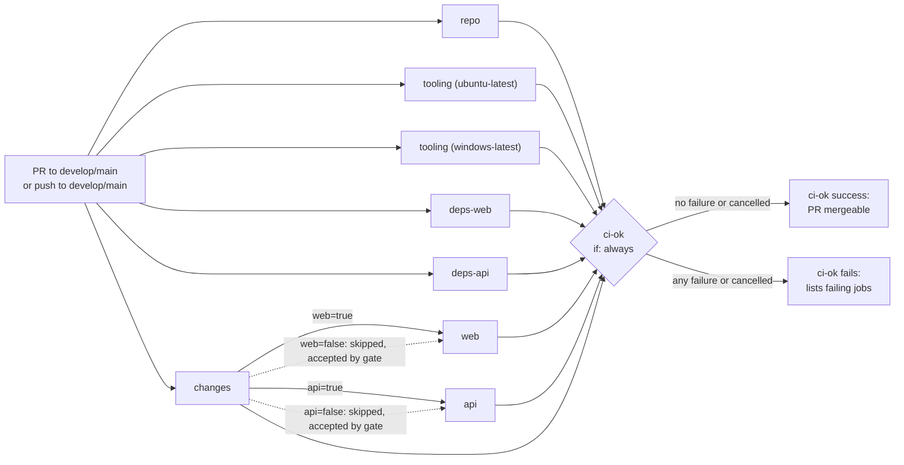
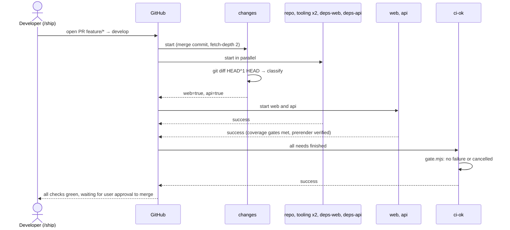
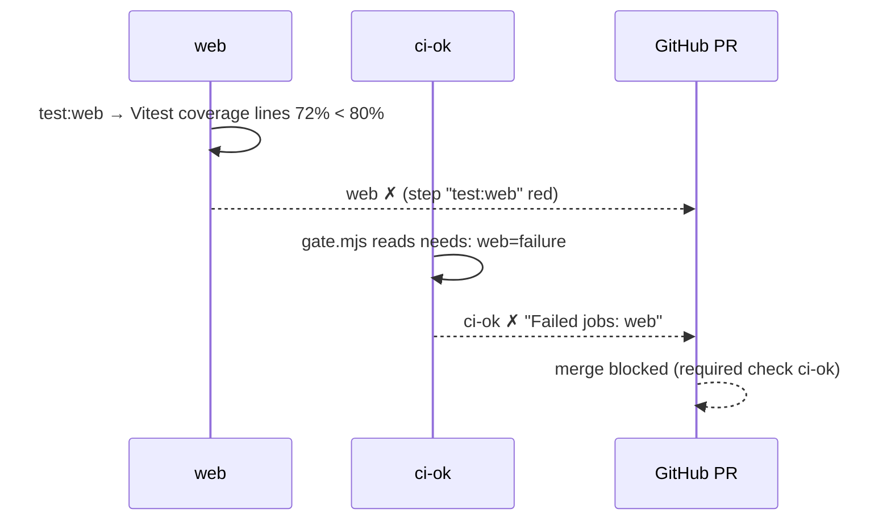
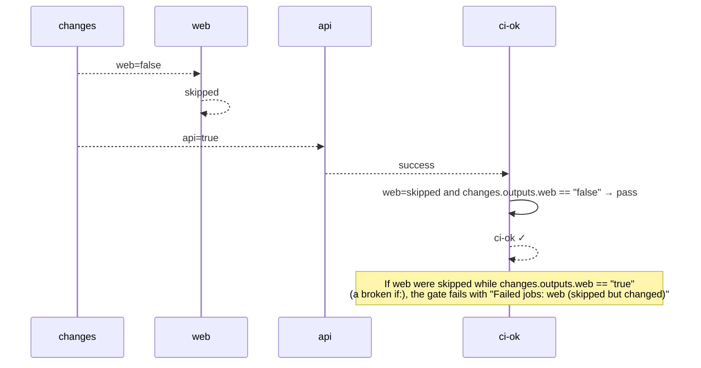
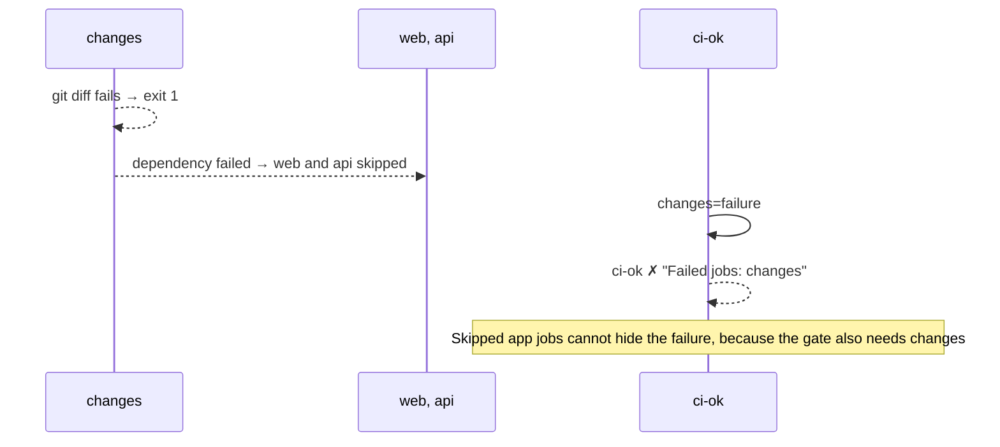
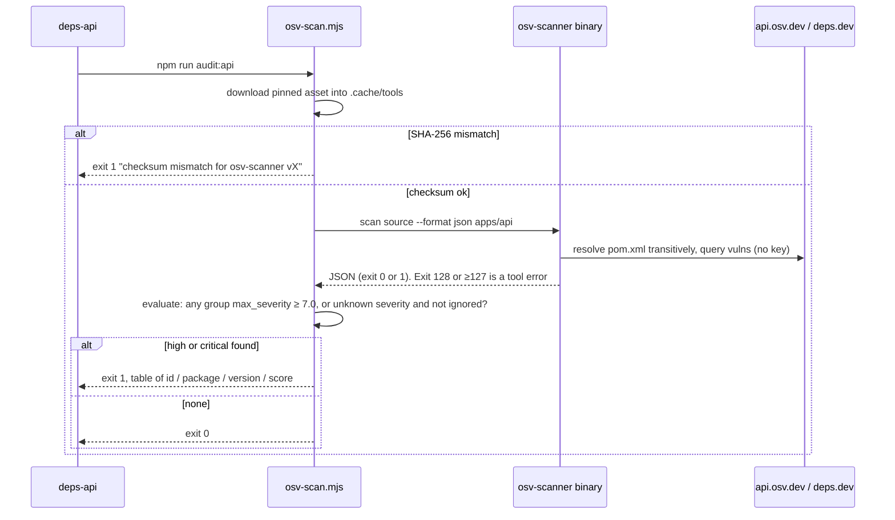

# 001 · Monorepo and tooling · Design

## Overview
Two independent projects (`apps/web` Angular, `apps/api` Spring Boot) sit side by side under one repo.
They share nothing at build time. A dependency-free root `package.json` gives one script per check
for each app, plus repo-level policy checks written as small zero-dependency Node scripts
(`scripts/`). CI calls exactly those scripts, so a developer on Windows 11 runs what Linux CI
runs. CI is one workflow (`.github/workflows/ci.yml`) with these parts: a change-detection job, one
job per concern (repo policy, tooling tests on two OSes, web, api, two dependency scans) and a
final aggregate job `ci-ok`. `ci-ok` always reports, so branch protection can require a single
stable check name. An app job that is skipped counts as success only when `changes` reported that
app as unchanged. Any other skip, and any failed or cancelled job, fails the gate with the job named.

Requirements covered: REQ-REPO-001…005, REQ-WEB-001…006, REQ-API-001…006, REQ-CI-001…010,
plus the non-functional items (speed, parity, security, supply chain, cost).

### Versions (as of 2026-11-17)
Every version below becomes an exact pin at implementation time. "(verify)" means it was not
confirmed against current docs during design, so the implementing task must confirm it.

| Tool | Version | Notes |
|---|---|---|
| Node.js | 24 LTS, exact patch ≥ 24.15.0 (verify patch) | Angular 22 supports `^22.22.3 \|\| ^24.15.0 \|\| ^26.0.0` (verified). 24 chosen over 26, see open questions |
| Angular / CLI / @angular/build / @angular/ssr | 22.x, latest patch (verify patch) | 22 is the newest line in the Angular support table (verified). Zoneless is the default since v21 (verified) |
| TypeScript | 6.0.x | Angular 22 requires `>=6.0.0 <6.1.0` (verified) |
| angular-eslint | 22.x, matching the Angular major (verify) | `ng add angular-eslint` follows the Angular major (verified README) |
| typescript-eslint / ESLint | 8.x / 9.x or 10.x (verify TS 6.0 support) | Risk R-3 |
| Prettier | 3.x (verify) | |
| Vitest + `@vitest/coverage-v8` + jsdom | versions required by `@angular/build` 22 (verify) | Through the Angular unit-test builder |
| @testing-library/angular | latest that supports Angular 22 (verify) | Dev only |
| Java | Temurin 25, exact patch (verify patch) | |
| Spring Boot | 4.1.x or latest 4.x GA, exact (verify patch) | 4.1 supports Java 17 up to 26 and Maven ≥ 3.6.3 (verified) |
| Maven / Maven Wrapper | 3.9.x (verify) / 3.3.x `only-script` (verify version) | `only-script` is the default type and commits no jar (verified). `distributionSha256Sum` is supported (verified) |
| Spotless Maven plugin | 3.x (verify) | `palantirJavaFormat` step and `check` bound to `verify` by default (verified) |
| palantir-java-format | latest 2.x (verify Java 25 syntax support) | Risk R-2 |
| JaCoCo | 0.8.15 or later | 0.8.14 added official Java 25 support. 0.8.15 (2026-06-04) adds official 26 support (verified) |
| ArchUnit (`archunit-junit5`) | 1.5.x (verify latest patch) | Max supported class file is Java 25 / major 69 (verified on main) |
| OSV-Scanner CLI | v2.6.x or later (verify latest) | Resolves `pom.xml` transitively through deps.dev and needs no key (verified) |
| Renovate (validator only) | exact npm version (verify), locked in `tools/renovate/package-lock.json` | `config:best-practices` contents verified. Bin path of `renovate-config-validator` inside the package (verify) |
| GitHub Actions | `actions/checkout` v7, `actions/setup-java` v6, `actions/setup-node` (verify major) | Pinned by SHA at T-time |

## Components

### Repository root
| Component | Location | Responsibility |
|---|---|---|
| Root scripts | `package.json` | `private: true`. Scripts only: no `dependencies`, no `workspaces`, no lockfile. The script contract is below (REQ-REPO-002) |
| Node pin | `.nvmrc` | Exact Node version. CI reads it through `setup-node` `node-version-file` (REQ-REPO-003) |
| Java pin | `.sdkmanrc` (`java=25.0.N-tem`) | Exact JDK. CI reads it through `setup-java` `java-version-file`. Locally, maven-enforcer checks major 25 (REQ-REPO-003) |
| Line endings | `.gitattributes` (extend existing) | Already has `* text=auto eol=lf` and `*.cmd`/`*.bat` CRLF. Add `mvnw text eol=lf`, `*.sh text eol=lf`, and binary rules for `*.jar *.ico *.gif *.jpeg *.webp *.avif *.ttf *.woff` (REQ-REPO-004) |
| Editor rules | `.editorconfig` (existing) | Already LF. Add `[*.xml] indent_size = 4` for `pom.xml` (REQ-REPO-004) |
| Ignore rules | `.gitignore` (extend) | Add `.cache/` (downloaded tool binaries) |
| Maven runner | `scripts/mvnw.mjs` | Runs `mvnw.cmd` on win32 and `./mvnw` elsewhere, with cwd `apps/api`. Forwards args and exit code. This makes root scripts identical on cmd.exe and sh. Every forwarded argument must pass an allow-list before anything is spawned (see "Maven runner argument allow-list") |
| Repo policy checks | `scripts/check-repo.mjs`, `scripts/checks/*.mjs` | Static checks with no dependencies. Each module exports `check(root): string[]` (list of errors). See the test strategy for which REQ each module proves |
| Change detection | `scripts/ci/changes.mjs` | Pure `classify(paths)` returns `{web, api}`. The CLI writes `web=`/`api=` to `$GITHUB_OUTPUT`, or prints them locally |
| CI gate | `scripts/ci/gate.mjs` | Reads `NEEDS` (JSON of `needs`, including `changes.outputs`) from env, prints a result table and exits 1 unless every job passes the gate rules (see "Gate rules") |
| Renovate validator lock | `tools/renovate/package.json`, `tools/renovate/package-lock.json` | `private: true`, one exact `renovate` devDependency, lockfile committed. Installed with `npm ci --ignore-scripts`, so the validator's whole tree is locked and no install scripts run (REQ-CI-008, NFR supply chain) |
| OSV runner | `scripts/osv-scan.mjs`, `scripts/lib/osv-gate.mjs` | Downloads the pinned OSV-Scanner binary to `.cache/tools/`, verifies its SHA-256, scans `apps/api`, and applies the high/critical gate (ADR-0002) |
| OSV pin | `tools/osv-scanner.json` | `{ version, assets: { linux_amd64, windows_amd64, darwin_arm64 }: { file, sha256 } }` |
| Script tests | `scripts/**/*.test.mjs` | `node:test` tests for every script above |
| Hook tests | `.claude/hooks/guard-bash.test.mjs`, `protect-secrets.test.mjs`, `lib.test.mjs`, `quality-gate.test.mjs`, helper `.claude/hooks/_spawn-hook.mjs` | Spawn each hook with `process.execPath`, pipe JSON to stdin, and assert the exit code (0 allow, 2 block) and the stderr reason (REQ-REPO-005) |
| Hook comment fix | `.claude/hooks/format.mjs` | Change the comment "google-java-format" to "palantir-java-format". No behaviour change |
| CI workflow | `.github/workflows/ci.yml` (replaces `.gitkeep`) | Job graph below |
| Renovate | `renovate.json` | Weekly, grouped, no automerge, SHA digests for Actions, PRs target `develop` (REQ-CI-008) |
| Changelog | `CHANGELOG.md` | One line per task under Unreleased |

### Web (`apps/web`)
Generated with the Angular CLI (`ng new` with SSR, zoneless, SCSS, routing, prefix `sf`, Vitest)
and then trimmed to static output.

| Component | Location | Responsibility |
|---|---|---|
| Manifest | `apps/web/package.json`, `package-lock.json` | Exact pins, `engines.node: ">=24.15.0 <25.0.0"`, scripts `dev test e2e lint typecheck build format format:check` (REQ-WEB-003, REQ-WEB-006) |
| npm config | `apps/web/.npmrc` | `save-exact=true`, `engine-strict=true` (REQ-WEB-006, REQ-REPO-003) |
| Workspace config | `apps/web/angular.json` | `outputMode: "static"`, a `server` entry (`main.server.ts`) for prerendering, no `ssr.entry` (no Express server), no `polyfills` (no zone.js). The test target uses `@angular/build:unit-test` with `runner: vitest`, `coverageThresholds.lines: 80` and reporters `text-summary` + `lcov`. Component schematics set `type: "component"` and `changeDetection: "OnPush"`, so generated files follow the `*.component.ts` naming in angular-standards |
| TS configs | `apps/web/tsconfig*.json` | `strict`, `strictTemplates` |
| Lint config | `apps/web/eslint.config.js` | angular-eslint flat config: `tsRecommended`, `templateRecommended`, `templateAccessibility`, selector prefix `sf`, `prefer-on-push-component-change-detection` (REQ-WEB-005) |
| Format config | `apps/web/.prettierrc.json`, `.prettierignore` | `endOfLine: "lf"`. Ignores `dist`, `coverage`, `.angular` |
| App shell | `apps/web/src/main.ts`, `main.server.ts`, `index.html` (`lang="en"`), `styles.scss`, `src/app/app.component.ts`, `app.config.ts`, `app.config.server.ts`, `app.routes.ts`, `app.routes.server.ts` | Standalone, zoneless bootstrap. Server routes: `{ path: '**', renderMode: RenderMode.Prerender }` (REQ-WEB-001) |
| Placeholder home | `apps/web/src/app/features/home/home-page.component.{ts,html,scss,spec.ts}` | Selector `sf-home-page`, route `''`, one `<main>` with one `<h1>`. Replaced by spec 005 (see open question Q-1 on hard-coded text) |
| Prerender verifier | `apps/web/scripts/verify-prerender.mjs` (npm `postbuild`) | Fails the build unless `dist/web/browser/index.html` (verify path) exists and contains the placeholder `<h1>` inside `sf-root`, and no `server.mjs` was emitted (REQ-WEB-002) |
| e2e stub | `apps/web/scripts/e2e-stub.mjs` | Prints "e2e: no tests until spec 004" and exits 0 (REQ-WEB-003) |

### API (`apps/api`)
| Component | Location | Responsibility |
|---|---|---|
| Build | `apps/api/pom.xml` | Parent `spring-boot-starter-parent` 4.x (exact). `java.version` 25. Dependencies: `spring-boot-starter-webmvc`, `spring-boot-starter-actuator`. Test scope: `spring-boot-starter-test` (plus the Boot 4 webmvc/RestTestClient test starter, verify name) and `archunit-junit5` |
| Plugins | same | maven-enforcer (`requireJavaVersion 25`, `requireMavenVersion 3.9`, `requirePluginVersions`, `banDynamicVersions`); maven-compiler (`-Xlint:all,-processing`, `failOnWarning`); surefire (`*Test`); failsafe (`*IT`, declared before JaCoCo); JaCoCo (`prepare-agent`, `prepare-agent-integration`, `merge`, `report`, `check` LINE COVEREDRATIO ≥ 0.85 on the merged file, all in `verify`); Spotless (`palantirJavaFormat`, `removeUnusedImports`, `check` at `verify`). Every version is explicit or comes from the Boot parent (REQ-API-003, 004, 006) |
| Wrapper | `apps/api/mvnw` (git mode 100755), `mvnw.cmd`, `.mvn/wrapper/maven-wrapper.properties` | `only-script` type with `distributionSha256Sum` (REQ-API-001) |
| Application | `apps/api/src/main/java/dev/sf/portfolio/PortfolioApplication.java` | `@SpringBootApplication`. Nothing else |
| Config | `apps/api/src/main/resources/application.yaml` | `management.endpoints.web.exposure.include: health`, `management.endpoints.web.discovery.enabled: false`, `management.endpoint.health.show-details: never`, `show-components: never`. Optionally `management.endpoints.access.default: none` with `health` set to `read-only` (verify property names in Boot 4) (REQ-API-002) |
| Health IT | `apps/api/src/test/java/dev/sf/portfolio/HealthEndpointIT.java` | `@SpringBootTest(webEnvironment = RANDOM_PORT, useMainMethod = ALWAYS)` with `@AutoConfigureRestTestClient` (both verified in Boot 4.1 docs). Calling `main` lets the bootstrap class count toward coverage without exclusions |
| Architecture rules | `apps/api/src/test/java/dev/sf/portfolio/architecture/ArchitectureRules.java` | `DOMAIN_IS_FRAMEWORK_FREE = noClasses().that().resideInAPackage("..domain..").should().dependOnClassesThat().resideInAnyPackage("org.springframework..", "jakarta..", "com.fasterxml.jackson..", "tools.jackson..", "..adapter..", "..adapters..")`. The rule covers both `..adapter..` (REQ wording) and `..adapters..` (spring-standards package name), because ArchUnit matches whole package segments. Jackson is included per spring-standards |
| Architecture test | `.../architecture/ArchitectureTest.java` | `@AnalyzeClasses(packages = "dev.sf.portfolio", importOptions = DoNotIncludeTests.class)`. The rule uses `allowEmptyShould(true)` until spec 010 adds a domain |
| Rule self-test | `.../architecture/ArchitectureRuleSelfTest.java` and fixtures in `.../architecture/fixture/domain/` and `.../fixture/adapters/` | Imports only the fixture classes and asserts the rule reports violations. This proves the rule can fail before any real domain exists (REQ-API-005) |
| OSV config | `apps/api/osv-scanner.toml` | Empty at first. Every ignore needs `reason` and `effectiveUntil` |

## Data and API contract

### Root script contract (REQ-REPO-002)
`npm run <script>` from the repo root behaves the same on Windows (cmd.exe) and Linux (sh), because
anything OS-specific goes through a Node script.

| Script | Runs | Used by CI job |
|---|---|---|
| `install:web` | `npm --prefix apps/web ci` | web |
| `lint:web` | `npm --prefix apps/web run lint`, which runs `ng lint` then `prettier --check .` | web |
| `format:check:web` | `npm --prefix apps/web run format:check` | (included in `lint:web`) |
| `typecheck:web` | `npm --prefix apps/web run typecheck`, which runs `tsc -p tsconfig.app.json --noEmit` and `tsc -p tsconfig.spec.json --noEmit` (template types are checked by `ng build`) | web |
| `test:web` | `npm --prefix apps/web run test`, which runs `ng test --no-watch --coverage` with lines ≥ 80 | web |
| `build:web` | `npm --prefix apps/web run build`, which runs `ng build` and then `postbuild` verify-prerender | web |
| `audit:web` | `npm --prefix apps/web audit --audit-level=high` | deps-web |
| `lint:api` | `node scripts/mvnw.mjs -B -ntp -q test-compile` (javac `-Xlint:all` with `failOnWarning` is the Java lint until a dedicated analyzer is adopted) | api |
| `format:check:api` | `node scripts/mvnw.mjs -B -ntp spotless:check` | api |
| `typecheck:api` | same goal as `lint:api` (javac is the type checker). Kept as a separate name so the contract is uniform | api (not repeated) |
| `test:api` | `node scripts/mvnw.mjs -B -ntp verify` (unit, IT, ArchUnit, JaCoCo ≥ 85 %, Spotless) | api |
| `build:api` | `node scripts/mvnw.mjs -B -ntp -DskipTests package` | (covered by `verify`) |
| `audit:api` | `node scripts/osv-scan.mjs apps/api` | deps-api |
| `format:web` / `format:api` | `prettier --write .` / `spotless:apply` | local only |
| `test:hooks` | `node --test ".claude/hooks/*.test.mjs"` (escaped double quotes, so Node expands the glob on both shells) | tooling |
| `test:scripts` | `node --test "scripts/**/*.test.mjs"` | tooling |
| `check:repo` | `node scripts/check-repo.mjs` | repo |
| `install:renovate` | `npm --prefix tools/renovate ci --ignore-scripts --no-audit --no-fund` | repo (same condition as `check:renovate`) |
| `check:renovate` | `node tools/renovate/node_modules/renovate/<validator bin> --strict renovate.json` (bin path verified at T-time). No `npx`, so nothing resolves outside the lockfile | repo (when `renovate.json` changed or on push) |
| `lint`, `format:check`, `typecheck`, `test`, `build`, `audit` | `:web` then `:api` | local convenience |
| `verify` | `check:repo`, `test:hooks`, `test:scripts`, `lint`, `typecheck`, `test`, `build:web`, `audit` in sequence | local "run what CI runs" |

### CI job contract and required check names (REQ-CI-002, REQ-CI-003)
The workflow is named `CI`. Check names are the job `name:` values and must not be renamed.

| Check name | Runs on | Condition | Steps (all root scripts) |
|---|---|---|---|
| `changes` | ubuntu-latest | always | checkout (fetch-depth 2), `node scripts/ci/changes.mjs` |
| `repo` | ubuntu-latest | always | `check:repo`, then `install:renovate` and `check:renovate` (if `renovate.json` or `tools/renovate/**` changed, or not a PR). `setup-node` `cache: npm` keyed on `tools/renovate/package-lock.json` |
| `tooling (ubuntu-latest)` | ubuntu-latest | always | `test:hooks`, `test:scripts` |
| `tooling (windows-latest)` | windows-latest | always | `test:hooks`, `test:scripts` |
| `web` | ubuntu-latest | `needs.changes.outputs.web == 'true'` | `install:web`, `lint:web`, `typecheck:web`, `test:web`, `build:web` |
| `api` | ubuntu-latest | `needs.changes.outputs.api == 'true'` | `format:check:api` (fast fail), `lint:api`, `test:api` with `-Dspotless.check.skip=true` (the format check already ran) |
| `deps-web` | ubuntu-latest | always (new CVEs appear without code changes) | `audit:web` |
| `deps-api` | ubuntu-latest | always | `audit:api` |
| `ci-ok` | ubuntu-latest | `if: always()`, needs all of the above | `node scripts/ci/gate.mjs` with `NEEDS: ${{ toJSON(needs) }}` passed through env |

**Branch protection requires only `ci-ok`** on `develop` and `main`. Every other job still reports
its own named check, so the failing job is visible in the PR. Applying protection stays out of
scope for this spec.

### Gate rules (`gate.mjs`, REQ-CI-002, REQ-CI-003)
The gate fails closed. `NEEDS` is keyed by job id (`changes`, `repo`, `tooling`, `web`, `api`,
`deps-web`, `deps-api`), not by check name, and a matrix job (`tooling`) has one aggregated result.
For each job in `NEEDS`:
- `success` passes.
- `failure` and `cancelled` fail.
- `skipped` passes only for `web` or `api`, and only when `changes.result` is `success` and
  `changes.outputs.<app>` is exactly the string `"false"`. A skip with the output `"true"`, missing
  or anything else fails. That catches a wrong `if:` on an app job, which would otherwise skip it silently.
- `skipped` for any other job (`changes`, `repo`, both `tooling`, `deps-web`, `deps-api`) fails, because they always run.
- Any other or missing `result` fails. An empty or unparsable `NEEDS` fails.
The result table prints the job, its result, and for a skipped app job the `changes` output that justified it.

### Maven runner argument allow-list (`scripts/mvnw.mjs`, REQ-REPO-002, NFR security)
On win32 the runner must start `mvnw.cmd` with `shell: true`, because Node refuses to spawn `.cmd`
files without a shell since the CVE-2024-27980 fix. cmd.exe still expands `%VAR%` and treats `^ & | < >`
as metacharacters inside double quotes, so quoting alone is not safe.
- Each forwarded argument must be non-empty and match `^[A-Za-z0-9][A-Za-z0-9_.:=,+/@-]*$` or
  `^-{1,2}[A-Za-z0-9][A-Za-z0-9_.:=,+/@-]*$`. That covers every argument in the root script contract
  (`-B`, `-ntp`, `-q`, `-DskipTests`, `-Dspotless.check.skip=true`, `test-compile`, `spotless:check`,
  `spotless:apply`, `verify`, `package`).
- Rejected characters include `% ^ & | < > " ' ! ( ) ; `` ` `` space, tab, CR, LF and every non-ASCII character.
- The same rule applies on every platform, so a command that works on Linux also works on Windows.
  Off win32 there is no shell (`./mvnw` with an args array), so the rule is parity and defence in depth there.
- On rejection the runner spawns nothing, prints `mvnw.mjs: rejected argument <JSON-escaped arg>`
  to stderr and exits 2.
- The executable and the cwd are constants, never taken from input.
- On win32 the runner spawns one command string, `.\mvnw.cmd` followed by the validated arguments
  joined by single spaces, with `shell: true` and no args array. Passing an args array with
  `shell: true` prints the DEP0190 deprecation warning at runtime on Node 24 (observed on 24.18.0), and
  Node only concatenates those args anyway. The allow-list contains no whitespace or metacharacters,
  so joining is exact. The `.\` prefix pins the file in cwd, so no `PATH` lookup happens and
  `NoDefaultCurrentDirectoryInExePath` has no effect.
- Off win32 it spawns `./mvnw` with an args array and no shell.

Change classification (`classify`, tested):
- `apps/web/**`, `content/**` → web
- `apps/api/**` → api
- `docs/**`, `specs/**`, `.claude/skills/**`, `.claude/agents/**`, `*.md` at the root → neither
- `.claude/hooks/**` → neither app (tooling always runs)
- `renovate.json`, `tools/renovate/**` → also `renovate` (runs `check:renovate` in `repo`)
- Anything else (`.github/**`, `scripts/**`, `tools/**`, root `package.json`, `.nvmrc`, `.sdkmanrc`,
  `.gitattributes`, `.editorconfig`, `renovate.json`) → web and api
- Non-PR events (push, schedule, workflow_dispatch) → web and api, with no filtering

For `pull_request`, the checkout is GitHub's merge commit, so `git diff --name-only HEAD^1 HEAD`
(fetch-depth 2) lists exactly what the PR changes against the current base. This needs no
third-party action and no API token.

### Workflow triggers and settings
- `pull_request` on branches `develop` and `main`. `push` on `develop` and `main` (REQ-CI-009).
  `workflow_dispatch`. `schedule` weekly (Monday 03:30 UTC) on the default branch, so new CVEs fail
  loudly even when nothing changes. The schedule is optional (Q-5).
- No trigger-level `paths:` filters. A workflow skipped by `paths:` leaves required checks pending
  forever, which is why the job-level `if:` plus `ci-ok` design exists (REQ-CI-002).
- Top level: `permissions: { contents: read }`. No job raises it (REQ-CI-005).
- `concurrency: { group: ci-${{ github.event.pull_request.number || github.ref }}, cancel-in-progress: ${{ github.event_name == 'pull_request' }} }`.
- Every job sets `timeout-minutes` (10, or 15 for api).
- `actions/checkout` uses `persist-credentials: false`.

### Caching (REQ-CI-007)
| Job | Mechanism | Key inputs |
|---|---|---|
| web, deps-web | `actions/setup-node` `cache: npm`, `cache-dependency-path: apps/web/package-lock.json` | lockfile hash (caches `~/.npm`) |
| api | `actions/setup-java` `cache: maven`, `cache-dependency-path: apps/api/pom.xml` and `apps/api/.mvn/wrapper/maven-wrapper.properties` | pom and wrapper hash (caches `~/.m2`, JDK) |
| tooling, repo, changes, ci-ok | no install step, so no cache | n/a |

GitHub scopes caches by ref, so a PR can read caches from `develop` but cannot write caches that
`develop` or `main` will use. This limits cache poisoning.

### Renovate (`renovate.json`, REQ-CI-008)
- `extends: ["config:best-practices", "schedule:weekly"]`. `config:best-practices` includes
  `helpers:pinGitHubActionDigests`, `:pinDevDependencies`, a 3-day `minimumReleaseAgeNpm` and
  weekly lockfile maintenance (verified).
- `timezone: "Asia/Kolkata"`, `automerge: false`, `rangeStrategy: "pin"`, `labels: ["dependencies"]`.
- Target branch `develop` (`baseBranchPatterns` or `baseBranches`, verify the current option name).
  Without it, Renovate would open PRs against `main` and break the branch flow.
- `packageRules`: groups `angular` (`@angular/**`, `@angular-devkit/**`, `angular-eslint`,
  `@angular-eslint/**`, `typescript`), `web npm non-major`, `api maven non-major`,
  `github-actions`, `toolchain` (nvm, sdkman (verify manager), maven-wrapper). Majors are
  separate PRs labelled `major`.
- `customManagers` (regex): the OSV-Scanner version in `tools/osv-scanner.json` (datasource
  `github-releases`, `google/osv-scanner`). The validator needs no custom manager: Renovate's npm
  manager updates `tools/renovate/package.json` and its lockfile, and the 3-day
  `minimumReleaseAgeNpm` applies. A checksum mismatch makes the OSV bump PR fail until a human updates the SHA-256
  values, which is deliberate (ADR-0002).
- Security PRs bypass the schedule (Renovate default). The Mend Renovate GitHub App is free for
  public repos. Installing it is a user action (Q-4).

### Health endpoint (informational; not part of `infra/openapi.yaml`, which arrives with the first product API)
```yaml
paths:
  /actuator/health:
    get:
      summary: Liveness and readiness summary
      responses:
        "200":
          description: Application is up
          content:
            application/vnd.spring-boot.actuator.v3+json:
              schema:
                type: object
                required: [status]
                properties:
                  status: { type: string, enum: [UP] }
                additionalProperties: false
# Every other /actuator/** path, including /actuator (discovery), returns 404.
```

### Tool data files
- `tools/osv-scanner.json`: `{ "version": "2.x.y", "assets": { "linux_amd64": { "file": "osv-scanner_linux_amd64", "sha256": "…" }, "windows_amd64": { … }, "darwin_arm64": { … } } }`. Verify the asset names at T-time.
- `apps/api/osv-scanner.toml`: `[[IgnoredVulns]] id, reason, effectiveUntil`. An ignore without
  `reason` fails `check:repo`.
- Gate input: OSV JSON `results[].packages[].groups[].max_severity` (CVSS score as a string,
  emitted since OSV-Scanner 1.7, verified).

## Flows

### CI job graph


### Main flow: PR that touches both apps


### Failure flow 1: a check fails (for example, web coverage below 80 %)


### Failure flow 2: api-only PR (skipped job accepted only when changes says so)


### Failure flow 3: change detection fails


### Failure flow 4: vulnerable or tampered dependency

`deps-web` follows the same shape with `npm audit --audit-level=high`, which exits non-zero on a
high or critical finding.

### Failure flow 5: run superseded or a job times out
A new push to the PR cancels the old run (`cancel-in-progress` for PRs only). `ci-ok` treats
`cancelled` as failure, so a half-finished run can never report green. The new run replaces it.
Push runs on `develop` and `main` are never cancelled, so every commit on a protected branch gets
a verdict.

### Local flow (parity)
On Windows 11 the developer runs `npm run verify` (or a single script). The same Node scripts and
Maven goals run, `mvnw.cmd` is chosen by `scripts/mvnw.mjs`, and LF endings come from
`.gitattributes`. The only CI-only logic is orchestration: change detection and the gate. Neither
of them is a quality check, and both can be run locally.

## Concurrency, failure and security

**Concurrency.** Jobs share no state. The only shared resources are the GitHub cache (scoped by
ref, keyed by content hash) and `.cache/tools`, which is written atomically: download to a temp
file, verify, then rename. The PR concurrency group prevents two runs of the same PR from racing
to report.

**Failure handling.**
- Each job fails on the first failing step, and the step is named after the root script, so the
  log shows exactly which check failed (REQ-CI-003).
- `ci-ok` uses `if: always()` and applies the gate rules: `success` is green. `failure`,
  `cancelled` and unknown results are red. `skipped` is green only for an app job whose `changes`
  output is `"false"`. `changes` is in `needs`, so a skipped app job cannot hide a detection
  failure, and a wrong `if:` cannot hide an app that did change.
- OSV tool errors (exit 127, 128, or any exit other than 0 and 1) fail closed. A vulnerability with
  no CVSS score counts as high unless it is explicitly ignored with a reason and an expiry date.
- Network flakiness (npm registry, osv.dev, Maven Central) shows up as a red job. Re-running the
  job is the remedy. No automatic retries hide real failures.

**Security.**
- `permissions: contents: read` at the top, and no job escalates. No `pull_request_target`, no
  `secrets.*`, no `id-token`. Fork PRs get a read-only token (REQ-CI-005, NFR security).
- Every `uses:` is pinned to a 40-hex commit SHA with `# vX.Y.Z`. That includes first-party
  `actions/*` (REQ-CI-004). Only `actions/checkout`, `actions/setup-node` and `actions/setup-java`
  are used, with no third-party actions. Change detection, gating and OSV are in-repo scripts.
- `checkout` uses `persist-credentials: false`, so later steps cannot reuse the token.
- No `${{ github.event.* }}` interpolation inside `run:` blocks. Untrusted values (`needs` JSON,
  base SHA) go through `env:` to prevent script injection.
- Supply chain: exact pins (npm `save-exact`, lockfile committed, `npm ci`). The Maven
  `banDynamicVersions` and `requirePluginVersions` enforcer rules are active. The Maven Wrapper
  distribution is verified by `distributionSha256Sum`. The OSV binary is verified by a pinned
  SHA-256. Renovate waits 3 days for new npm releases (`minimumReleaseAgeNpm`) and never automerges.
  The Renovate validator runs from a committed lockfile (`tools/renovate/`) installed with
  `npm ci --ignore-scripts`. It never runs through `npx`, which would resolve an unlocked tree on every run.
- `scripts/mvnw.mjs` is the only place a shell is used (`mvnw.cmd` on win32). Its arguments pass
  the allow-list first, and the executable and cwd are constants.
- The API exposes only `/actuator/health`, with no details or components, and discovery is off
  (REQ-API-002, security-baseline).
- The hook tests protect the agent-safety controls themselves (guard-bash, protect-secrets) on
  both OSes (REQ-REPO-005, REQ-CI-010).
- No secrets are read anywhere. npm audit, OSV and Renovate validation are all key-free.
- Threat model: add a "CI" entry when `docs/threat-model.md` is created (spec 014). Not created here.

## Performance and accessibility impact
Nothing is measured in this spec. Lighthouse CI and axe arrive with specs 004 and 016.
- **Initial JS:** a zoneless standalone app with one route and no zone.js. It is expected to be
  well under the 120 KB gzipped budget (estimated, not measured). Angular CLI `budgets` keep the
  CLI defaults, because they measure raw size, not gzip. The real gzip budget is enforced by
  Lighthouse CI later.
- **LCP / CLS:** the prerendered static HTML has one text heading, no images, no web fonts and no
  layout shift sources.
- **Accessibility:** `<html lang="en">`, a `<title>`, one `<main>` with one `<h1>`, no motion. The
  angular-eslint `templateAccessibility` rules are on from day one.
- **CI speed (NFR ≤ 10 min warm):** jobs run in parallel. Estimated wall time is about 4–6 min: web
  ≈ 3 min, api ≈ 3 min, Windows tooling ≈ 1–2 min. The measured time is recorded in the CI task's
  PR.

## Alternatives considered
| Decision | Chosen | Rejected and why |
|---|---|---|
| Path filtering | Job-level `if:` from an in-repo `changes` job plus an always-running `ci-ok` gate | Trigger-level `paths:`: skipped workflows leave required checks pending forever. `dorny/paths-filter`: one more third-party action with `pull-requests: read`. Requiring every job name in branch protection: renaming or adding a job silently changes protection, while one gate name is stable |
| Root wiring | Plain root scripts plus `scripts/mvnw.mjs` | npm workspaces, Nx, Turborepo: ruled out by the user. Inline `./mvnw` in root scripts: breaks on cmd.exe |
| Windows `.cmd` spawning | `shell: true` plus a strict argument allow-list | Quoting only: cmd.exe still expands `%VAR%` and `^` inside quotes. Running `java -classpath .mvn/wrapper/...` directly: `only-script` commits no jar, so there is nothing to call. Spawning `cmd.exe /d /s /c` by hand: the same parsing problem with more code |
| Renovate validator | Locked `tools/renovate/` (package.json + lockfile, `npm ci --ignore-scripts`) | `npx renovate@X.Y.Z`: the top-level version is exact but its transitive tree is re-resolved on every run. Docker image pinned by digest: needs Docker locally on Windows (same reason as for OSV) |
| Skipped-job policy in the gate | `skipped` accepted only for an app job whose `changes` output is `"false"` | Accept any `skipped`: a wrong `if:` silently drops a whole app from CI while `ci-ok` stays green |
| Maven vuln scanner | OSV-Scanner CLI, pinned plus checksum, with an in-repo severity gate (ADR-0002) | OWASP Dependency-Check: slow NVD download, and an NVD API key is practically required. The OSV reusable workflow: uploads SARIF, needs `security-events: write`, has no severity threshold, and cannot run locally. Snyk or Mend: need accounts or keys. The OSV Docker image: Renovate-friendly digest pinning, but requires Docker locally on Windows |
| Java lint | javac `-Xlint:all` with `failOnWarning` | **Error Prone deferred.** It needs about 11 `--add-exports` flags for javac internals in `.mvn/jvm.config`, historically lags each new JDK (Java 25 support not verified), lengthens builds, and is not in the agreed core gates. Revisit in spec 010 together with NullAway, once there is real domain code worth analysing. Checkstyle or PMD: overlap with the formatter and add noise on a skeleton |
| Formatter | Spotless + palantir-java-format (user decision) | google-java-format, the current text of spring-standards: superseded by the user's choice. The skill needs updating (Q-2) |
| Coverage of bootstrap class | `@SpringBootTest(useMainMethod = ALWAYS)` | Excluding `PortfolioApplication` from JaCoCo: would leave 0 coverable lines in the skeleton, making the ratio undefined, and sets an exclusion precedent |
| ArchUnit on an empty domain | `allowEmptyShould(true)` plus a fixture-based self-test | A dummy domain class: production code that exists only to satisfy a test |
| Prerender check | `postbuild` script on the real build output | A Playwright smoke test: out of scope until spec 004 |
| Node line | 24 LTS | 26 LTS: newer, but tooling support (typescript-eslint, Renovate managers) is less proven today. Renovate will propose it |
| Web typecheck | `tsc --noEmit` for app and spec configs (templates are checked in `ng build`) | `ngc --noEmit`: undocumented flag behaviour |
| Prettier on root files | Not gated in this spec (the format hook still formats them locally) | Root Prettier in the `repo` job: needs an install or an `npx` version kept in sync with apps/web (Q-6) |

## Test strategy
Test names follow `REQ-<AREA>-NNN <behaviour>`. "Acceptance" means an observed CI run on the PR
that lands the CI task, recorded in the PR description.

| REQ | Test type | Test name / check |
|---|---|---|
| REQ-REPO-001 | node:test (`scripts/checks/layout.test.mjs`) + CI | `REQ-REPO-001 apps are independent projects (no workspaces field, web has its own lockfile, api has its own pom and wrapper)`. The web and api jobs each build from their own folder |
| REQ-REPO-002 | node:test (`scripts/checks/scripts-contract.test.mjs`, `scripts/mvnw.test.mjs`) | `REQ-REPO-002 root package.json defines lint, format:check, typecheck, test, build for web and api` and `has no dependencies or workspaces`. `mvnw.test.mjs`: `REQ-REPO-002 mvnw accepts every argument in the root script contract`, `REQ-REPO-002 mvnw rejects <char>` (one case per rejected character class: `%`, `^`, `&`, `\|`, `<`, `>`, `"`, `'`, `!`, `(`, `)`, `;`, backtick, space, tab, CR, LF, non-ASCII, empty string), `REQ-REPO-002 mvnw spawns nothing and exits 2 on a rejected argument` |
| REQ-REPO-003 | node:test (`scripts/checks/toolchain.test.mjs`) | `REQ-REPO-003 .nvmrc is exact and satisfies apps/web engines`, `REQ-REPO-003 .sdkmanrc java major equals pom java.version`, `REQ-REPO-003 workflow uses node-version-file and java-version-file` |
| REQ-REPO-004 | node:test (`scripts/checks/line-endings.test.mjs`) | `REQ-REPO-004 .gitattributes forces LF and CRLF only for cmd/bat`, `REQ-REPO-004 no tracked text file has CRLF in the index (git ls-files --eol)`, `REQ-REPO-004 mvnw is tracked as 100755` |
| REQ-REPO-005 | node:test (`.claude/hooks/*.test.mjs`) | guard-bash: `blocks force push`, `blocks push to main and develop`, `allows push of a feature branch`, `allows --dry-run push to main`, `blocks --no-verify`, `blocks gh pr merge --admin`, `blocks curl piped to sh`, `blocks reading .env but allows .env.example`, `blocks git add docs/private`, `allows rm -rf of build folders`, `blocks rm -rf of src`, `blocks Remove-Item -Recurse outside build folders`, `allows ordinary commands`. protect-secrets: `blocks .env, .env.local, secrets/, *.pem, *.key, id_rsa`, `allows .env.example`, `blocks Glob pattern **/.env`, `blocks Write to docs/private but allows Read`, `normalises Windows backslash paths`. lib: `rel() returns repo-relative forward-slash paths`. quality-gate: `exits 0 when stop_hook_active`. All prefixed `REQ-REPO-005` |
| REQ-WEB-001 | Vitest + node:test | `REQ-WEB-001 app runs without Zone.js` (`app.config.spec.ts`: `globalThis.Zone` undefined, app boots in TestBed). `scripts/checks/web-config.test.mjs`: `REQ-WEB-001 zone.js absent, outputMode static, server routes prerender`. ESLint `prefer-standalone` and OnPush rules |
| REQ-WEB-002 | Vitest + build script | `REQ-WEB-002 home route renders the placeholder heading` (`home-page.component.spec.ts`, Testing Library `getByRole('heading', { level: 1 })`), `REQ-WEB-002 '' route resolves to HomePageComponent` (`app.routes.spec.ts`), plus `verify-prerender.mjs` failing `npm run build` if `index.html` lacks the heading |
| REQ-WEB-003 | node:test (`scripts/checks/web-config.test.mjs`) | `REQ-WEB-003 web defines dev, test, e2e, lint, typecheck, build`, `REQ-WEB-003 e2e stub exits 0` |
| REQ-WEB-004 | node:test + CI + one-off negative proof | `REQ-WEB-004 angular.json test target sets lines threshold 80`. The CI `test:web` step. The task's done criteria include showing the run fails with an untested file |
| REQ-WEB-005 | CI + one-off negative proof | `lint:web` step. Done criteria: an unformatted file and an ESLint error each make `npm run lint` exit non-zero |
| REQ-WEB-006 | node:test (`scripts/checks/pins.test.mjs`) | `REQ-WEB-006 no ^ or ~ in dependencies, devDependencies, optionalDependencies, overrides`, `REQ-WEB-006 package-lock.json is committed` |
| REQ-API-001 | node:test (`scripts/checks/api-build.test.mjs`) + CI | `REQ-API-001 wrapper scripts and properties with distributionSha256Sum exist`, `REQ-API-001 parent is spring-boot-starter-parent 4.x and java.version is 25`. Enforcer `requireJavaVersion` |
| REQ-API-002 | Spring Boot IT (`HealthEndpointIT`) | `REQ-API-002 health returns 200 with status UP`, `REQ-API-002 health hides details and components`, `REQ-API-002 other actuator endpoints return 404` (`/actuator`, `/actuator/info`, `/actuator/env`, `/actuator/beans`, `/actuator/metrics`) |
| REQ-API-003 | Maven build + one-off negative proof | JaCoCo `check` (LINE ≥ 0.85, merged unit + IT data) in `verify`. Done criteria: adding an untested class makes `./mvnw verify` fail |
| REQ-API-004 | Maven build + one-off negative proof | Spotless `check` in `verify` and the CI `format:check:api` step. Done criteria: a misformatted file makes both fail |
| REQ-API-005 | ArchUnit (`ArchitectureTest`, `ArchitectureRuleSelfTest`) | `REQ-API-005 domain does not depend on Spring, Jakarta, Jackson or adapters`, `REQ-API-005 rule reports a domain class that imports Spring`, `REQ-API-005 rule reports a domain class that uses an adapters class` |
| REQ-API-006 | Maven enforcer + node:test | `banDynamicVersions`, `requirePluginVersions`. `scripts/checks/pins.test.mjs`: `REQ-API-006 pom has no version ranges, LATEST or RELEASE` |
| REQ-CI-001 | node:test (`scripts/checks/workflow.test.mjs`) + acceptance | `REQ-CI-001 workflow triggers on pull_request to develop and main`, `REQ-CI-001 web and api jobs run lint, typecheck, test, build and tooling runs test:hooks` |
| REQ-CI-002 | node:test (`scripts/ci/changes.test.mjs`, `gate.test.mjs`) + acceptance | `REQ-CI-002 api-only change skips web`, `REQ-CI-002 docs-only change skips both apps`, `REQ-CI-002 root config change runs both`, `REQ-CI-002 non-PR event runs both`, `REQ-CI-002 skipped app job passes when changes says unchanged`, `REQ-CI-002 skipped app job fails when changes says changed`, `REQ-CI-002 skipped app job fails when changes outputs are missing`, `REQ-CI-002 skipped always-on job fails`, `REQ-CI-002 empty or invalid NEEDS fails`. Acceptance: an api-only PR shows `web` skipped and `ci-ok` green |
| REQ-CI-003 | node:test (`gate.test.mjs`) + acceptance | `REQ-CI-003 gate fails and names each failed or cancelled job` |
| REQ-CI-004 | node:test (`workflow.test.mjs`) | `REQ-CI-004 every uses: is pinned to a 40-hex SHA with a version comment` |
| REQ-CI-005 | node:test (`workflow.test.mjs`) | `REQ-CI-005 top-level permissions are contents: read and no job escalates`, `REQ-CI-005 pull_request_target is absent`, `no secrets.* reference` |
| REQ-CI-006 | node:test (`scripts/lib/osv-gate.test.mjs`, `scripts/osv-scan.test.mjs`) + CI | `REQ-CI-006 CVSS 7.0 fails`, `6.9 passes`, `missing severity fails`, `ignored id with reason passes`, `exit 128 fails closed`, `checksum mismatch fails`. The `deps-web` and `deps-api` jobs |
| REQ-CI-007 | node:test (`workflow.test.mjs`) + acceptance | `REQ-CI-007 setup-node caches npm keyed on apps/web/package-lock.json`, `REQ-CI-007 setup-java caches maven keyed on apps/api/pom.xml`. Acceptance: the second run logs a cache hit |
| REQ-CI-008 | `check:renovate` + node:test (`scripts/checks/renovate.test.mjs`) | `REQ-CI-008 renovate is weekly, never automerges, pins action digests, targets develop, groups updates`, `REQ-CI-008 validator is locked in tools/renovate (exact version, lockfile present, no npx in check:renovate)` plus `renovate-config-validator --strict` |
| REQ-CI-009 | node:test (`workflow.test.mjs`) + acceptance | `REQ-CI-009 workflow triggers on push to develop and main`. Acceptance: the run after the first merge to develop |
| REQ-CI-010 | node:test (`workflow.test.mjs`) + acceptance | `REQ-CI-010 tooling matrix is ubuntu-latest and windows-latest, every other job is ubuntu-latest` |
| NFR speed | acceptance | Warm-cache wall time ≤ 10 min, recorded in the PR |
| NFR parity | review | Every CI `run:` is `npm run <script>` or `node scripts/…`. Enforced by `REQ-CI-001` workflow test `run steps only call root scripts` |

`workflow.test.mjs` parses `ci.yml` with line-based rules, because Node has no built-in YAML
parser and no dependency is added. The rules are deliberately narrow (`uses:` lines, the
top-level `permissions:` block, `on:` keys, `runs-on:`). The acceptance runs cover the semantics.

## Risks
| ID | Risk | Fallback |
|---|---|---|
| R-1 | Mainstream tools trail Java 25 (JaCoCo needs ≥ 0.8.14; ArchUnit's maximum supported class file is 25) | Both are verified for 25. Stay on 25 (LTS). Do not adopt 26 until ArchUnit supports it |
| R-2 | palantir-java-format may mis-handle newest Java syntax, or Spotless may need `--add-exports` in `.mvn/jvm.config` on JDK 25 | Pin a palantir version verified at T-time. If formatting fails on JDK 25, add `.mvn/jvm.config` exports first. Switching formatter (for example `googleJavaFormat` AOSP style) would reopen a user decision, so it needs the user's approval |
| R-3 | typescript-eslint may not yet officially support TypeScript 6.0 (warning or breakage) | Use the angular-eslint release paired with Angular 22, which pins a compatible typescript-eslint. Treat the "unsupported TS" warning as non-fatal only if lint still passes |
| R-4 | `npm audit --audit-level=high` includes dev tooling, so a transitive high CVE in the Angular CLI can block every PR | Fix through a Renovate bump. Otherwise use a time-boxed `overrides` entry recorded in the PR. Never lower the level |
| R-5 | OSV resolves `pom.xml` through deps.dev and does not include test-scope dependencies | Accepted: test dependencies are not shipped. Spec 016 adds an SBOM-based image scan |
| R-6 | The pinned OSV checksum makes Renovate's OSV bump PR red until a human updates the SHA-256 values | Deliberate trust-on-first-use step. The steps are documented in `tools/osv-scanner.json` (`_comment`) and ADR-0002 |
| R-7 | Windows runners are slower and have quirks (paths, `shell: true` spawning) | Hooks spawn with `process.execPath` (no shell). Tests use `path` helpers. Only the tooling job runs on Windows. `mvnw.mjs` is the one shell spawn, and its argument allow-list is tested on both OSes in the tooling matrix |
| R-9 | `npm ci --ignore-scripts` may break the validator if a Renovate dependency needs an install script (for example a native module) | Verify at T-16 that `renovate-config-validator --strict` runs on Windows 11 and Linux with scripts off. If it does not, stop and bring the choice back to the user. Do not drop `--ignore-scripts` silently |
| R-8 | `useMainMethod = ALWAYS` and `@AutoConfigureRestTestClient` are verified in Boot 4.1 docs, but the name of the test starter that provides `RestTestClient` is not (verify) | Use `TestRestTemplate` with `@AutoConfigureTestRestTemplate` (also documented in 4.1) |

## Decisions on open questions (user, 2026-11-17)
- **Q-1 Placeholder text:** approved. Time-boxed scaffold exception limited to
  `home-page.component.html` (no personal or employer content), removed by spec 005.
- **Q-2 Formatter docs:** approved. Tasks update `.claude/skills/spring-standards/SKILL.md` and the
  `format.mjs` comment to palantir-java-format.
- **Q-3 Node line:** 24 LTS.
- **Q-4 Renovate app + Dependabot alerts:** user action after this spec merges (free).
- **Q-5 Weekly scheduled run:** keep the Monday CVE run on `main`.
- **Q-6 Prettier on root files:** deferred; not gated in this spec.
- **Q-7 Branch protection:** after the CI task merges, require `ci-ok` on `develop` and `main` as a
  separate, user-approved step outside this spec.

## Revision 2026-11-18: security fixes from the PR #4 review
This revision fixes the three medium design findings. Requirements are unchanged.
1. **Maven runner shell injection:** arguments are allow-listed before spawning, and on win32 they are passed as one validated command string, which also avoids the Node 24 DEP0190 warning (see "Maven runner argument allow-list"). Affects T-02.
2. **Gate accepted any skip:** `skipped` now passes only for an app job that `changes` reported as unchanged (see "Gate rules"). Affects T-17 and T-18.
3. **Unlocked Renovate run:** the validator is locked in `tools/renovate/` and installed with `npm ci --ignore-scripts`, with no `npx` (see the Renovate validator lock component). Affects T-16, T-17 and T-18.

## ADRs
- docs/adr/0001-baseline-runtime-dependencies.md
- docs/adr/0002-dependency-vulnerability-scanning.md

Status: APPROVED (2026-11-18, security revision; first approved 2026-11-17)
