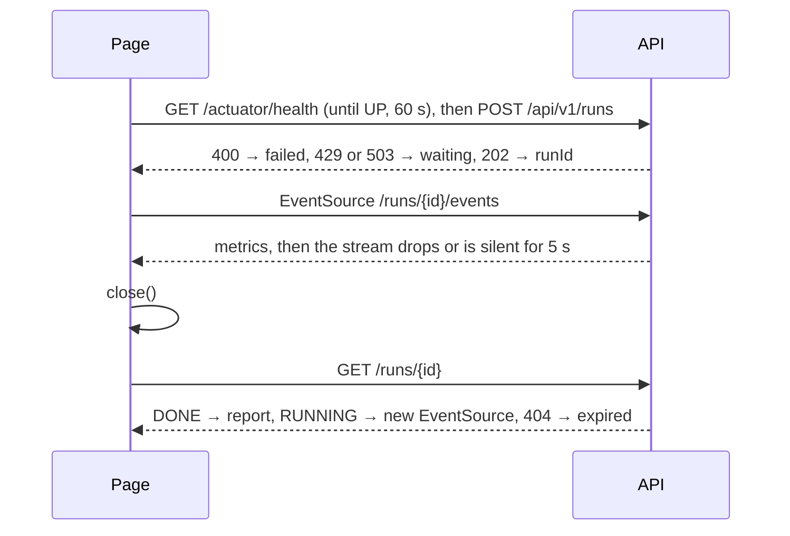

# 004 · v2 Lab page · Spec

Release v2.0, target Tue 1 Dec 2026 (ADR-0004). One spec, approved once. API source of truth: settlement-lab
`docs/api-contract.md` (approved 2026-11-23, "the contract"). Layout: settlement-lab `docs/explainer/ui-mockup.svg`.

## 1. Goal

An interviewer opens `/lab`, picks a ledger, thread model and fault profile, presses Run, watches the engine work and
sees the six invariants pass or fail. A recruiter who arrives while the API is asleep, busy or down still gets a page that
explains itself.

## 2. Requirements (EARS)

### Page and content

- REQ-LAB-001 THE site SHALL prerender `/lab` as a static shell (heading, lede, form, empty panels, a `<noscript>` note);
  no API call SHALL happen during prerender, and the API code SHALL be in the lazy `/lab` chunk only.
- REQ-LAB-002 THE page SHALL read all copy from `content/lab.yaml`. API enum values are contract data, shown next to
  a content label.
- REQ-LAB-003 WHILE `lab.yaml` has `published: false`, THE build SHALL leave `/lab` out of the nav, the sitemap and the
  project link, and the page SHALL be `noindex` but reachable by URL for testing.
- REQ-LAB-004 WHILE published, `/lab` SHALL be in the nav ("Lab", after Projects) and sitemap, have its own title,
  description and canonical URL (`/lab/`), and be linked from `/projects/settlement-lab`.

### Settings form

- REQ-LAB-010 THE form SHALL offer exactly: `ledger` LOCKING | CAS, `threads` PLATFORM | VIRTUAL, `faults` NONE | FLAKY |
  OUTAGE (radio groups), `transfers` integer 1 to 20,000, `duplicatePercent` integer 0 to 10 (number inputs). Defaults:
  LOCKING, VIRTUAL, FLAKY, 20,000, 2.
- REQ-LAB-011 IF a number is empty, not a whole number or out of range, THEN THE form SHALL send nothing, set
  `aria-invalid`, show a text error tied by `aria-describedby`, and focus the first invalid field.
- REQ-LAB-012 THE form SHALL send the five fields and no others, and SHALL ignore a second submit while one is active.

### Live view and invariants

- REQ-LAB-020 THE page SHALL show four tiles: Transfers / s (`throughputPerSecond`), p99 latency (`p99Micros`), Queue
  depth (`queueDepth / queueCapacity`), GL breaker (pill with the state as text). No value yet shows a dash.
- REQ-LAB-021 THE chart SHALL be inline SVG drawn from `metrics` events, at most one redraw per event (4 per second):
  throughput (solid) and GL retries per second (dashed, computed from `glRetries` and `elapsedMs`), each scaled to its
  own peak, with both peaks printed in the legend.
- REQ-LAB-022 THE chart SHALL be `role="img"` with a short name, a text summary (peak and final throughput, total
  retries) written once at the end, and a `
` table with one row per second.
- REQ-LAB-023 IF a run ends with fewer than two samples, THEN THE page SHALL say the run finished too fast to chart and fill
  throughput and p99 from the `report`.
- REQ-LAB-030 WHEN a `report` arrives, THE panel SHALL list all six invariants in contract order, each with an icon, the word
  Passed or Failed, a plain label and the contract name; a failed one SHALL show its counterexample as text.
- REQ-LAB-031 THE panel SHALL show opening and closing totals, duplicates sent and applied, and duration.
- REQ-LAB-032 THE overall result SHALL be "passed" only if all six are present, all six passed and `allPassed` is true;
  a missing invariant SHALL show "Not reported".

### Run states (details in section 3)

- REQ-LAB-040 WHEN the page loads in an allowed origin, THE page SHALL call `GET /actuator/health`, show "checking", then
  "starting the engine" after 1.5 s without an answer, until `{"status":"UP"}`; IF 60 s pass, THEN show "demo
  offline" with a Try again button and a link to the project write-up.
- REQ-LAB-041 IF the run stops early (`stoppedEarly`), THEN THE page SHALL say so with `transfersCompleted` of `transfers`.
- REQ-LAB-042 IF the API answers 400, THEN THE page SHALL show a form-level error with the problem `detail` and keep the settings.
- REQ-LAB-043 IF POST answers 429 or 503, THEN THE page SHALL show a countdown from `Retry-After`, keep Run disabled
  until it ends, and keep the last report on screen.
- REQ-LAB-044 IF the event stream drops, THEN THE page SHALL recover through `GET /api/v1/runs/{id}` (section 3); IF that
  answers 404, THEN show "this run has expired".
- REQ-LAB-045 IF the page is on an origin the API does not allow, THEN THE page SHALL make no API call and link to
  `https://siddheshfulawade.com/lab/`.
- REQ-LAB-046 WHEN the visitor leaves the page, THE page SHALL close the stream, abort requests and clear timers; late events
  of an earlier run SHALL be ignored.

### Accessibility, security, non-functional

- REQ-LAB-050 ONE polite `role="status"` region SHALL announce state changes only (not metrics, not countdown ticks; a
  countdown is announced once at start and once at end). Tiles and chart are not live regions.
- REQ-LAB-051 WHILE `prefers-reduced-motion: reduce`, tiles and chart SHALL update at most once per second, without transitions.
- REQ-LAB-052 THE CSP `connect-src` SHALL add exactly `https://api.siddheshfulawade.com`, emitted only by
  `apps/web/scripts/emit-headers.mjs`; no other directive changes.
- REQ-LAB-053 THE page SHALL treat every API response as untrusted: validate types, ranges and enums before use, ignore
  unknown fields, render text by interpolation only, and build URLs itself from a checked `runId` (never follow `eventsUrl`
  or `Location`).
- REQ-LAB-054 Money SHALL be shown in minor units as grouped integers (`1,000,000,000 minor units`); numbers in
  international format; a value that is not a safe integer SHALL be rejected, not rounded.

Non-functional: no new runtime dependency (`fetch`, `EventSource`, signals; `@angular/forms` is not installed). Initial JS
≤120 KB gzipped (main is 86.55 KB; this spec adds ≤1 KB); `/lab` chunk ≤15 KB gzipped; LCP ≤1.8 s (prerendered text);
CLS ≤0.05 (tiles, chart, panel and status line keep a reserved height in every state); INP ≤200 ms. WCAG 2.2 AA.
No cookies, no storage, no secrets, zero cost.

## 3. Design (short)

Files live in `apps/web/src/app/features/lab/` unless a path is given.

- **Content**: `content/lab.yaml` and `content/_schema/lab.schema.json` (shared fields, `apiBaseUrl`, `allowedOrigins`,
  `form`, `tiles`, `chart`, `invariants` with exactly the six names, `states`, `limitsNote`); `site.schema.json` requires
  `pages.lab`; `project.schema.json` gains optional `demo` (site path); `site.ui.demoLink`. `build-content.mjs` writes
  lab copy to its own `src/generated/lab.json`, read by `core/content/lab-content.service.ts`, so it is not in the main bundle
  (`content.json` is). `SeoService.page` gains an `index` option.
- **API client** (`run/lab-api.ts`): `health`, `start`, `status`, `events`, injected `fetch` and `EventSource` factory.
  `credentials: 'omit'`; timeouts: health 10 s per try (retry every 3 s), POST 15 s, GET 10 s. POST is never retried
  (it has no idempotency key and counts against the limit). The contract is Markdown, so types are hand-written in one
  place, `run/lab-contract.ts`, with limits and validators (a deviation from the "generated client" standard).
- **State machine** (`run/lab-state.ts`): pure `next(state, event)`; `run/lab-run.store.ts` runs the effects and holds signals.
- **UI**: `lab-page` (layout, status region), `lab-form`, `lab-chart`, `lab-invariants`; `StatusPillComponent` gains an explicit
  `tone` input with `failed`. Chart keeps the last 240 samples and sets SVG attributes only. No `[style]` bindings: prerendered
  `style` attributes would break the CSP. Run is natively `disabled` in the prerendered HTML (no native submit before hydration;
  `form-action 'none'` blocks it too) and `aria-disabled` while running or waiting, so focus is not lost. At most four new stylesheets: each adds a 54-character hash to a CSP line of about
  1,200 of 2,000 characters.
- **Formatting** (`shared/format/number.ts`): `225,608`; `735 µs`, then ms from 1,000 µs, then s; `12 / 1,024`.
- **Base URL**: `apiBaseUrl` in `lab.yaml` (public, not a secret). `emit-headers.mjs` holds the CSP constant; a script test
  fails if the two differ.

### States

| State               | Entered when                                     | Shown                                        | Run         |
| ------------------- | ------------------------------------------------ | -------------------------------------------- | ----------- |
| elsewhere           | origin not in `allowedOrigins` and not localhost | link to the apex page                        | off         |
| checking, starting  | load; 1.5 s without health                       | "starting the engine, usually a few seconds" | off         |
| offline             | no `UP` within 60 s                              | explanation, Try again, project link         | off         |
| idle                | health `UP`, or a wait ended                     | form, limits note                            | on          |
| submitting, running | POST sent; 202                                   | tiles and chart                              | off         |
| recovering          | stream dropped                                   | last values stay, "reconnecting"             | off         |
| done                | `report` (stream or GET)                         | invariants; amber note if `stoppedEarly`     | on          |
| waiting             | POST 429 or 503                                  | "try again in 21 min" (seconds below 1 min)  | off until 0 |
| failed              | 400; GET 404; network, other status, bad body    | one message per cause                        | on          |

Countdown: `Retry-After` header, else body `retryAfterSeconds`, else 60 s (429) or 5 s (503); clamped to 1 to 3,600 and
counted from a deadline timestamp, so a background tab does not drift. Errors made by Cloudflare or Cloud Run
carry no CORS headers, so the browser reports only a network error: shown as "could not reach the engine".

### Main flow and stream recovery

The main flow is drawn in settlement-lab `docs/explainer/ui-sequence.svg`. Failure flows:

- **Auto-reconnect is not used.** After a clean end or a network error, `EventSource` reconnects by itself and sends
  `Last-Event-ID` (the metrics `id`). The contract defines no replay, and a reconnect after `report` would fetch the
  report again in a loop until it expires. So the page always calls `close()` on `report` and on the first `error`,
  then asks GET. A new `EventSource` sends no `Last-Event-ID`; a gap in the chart is drawn as a gap.
- **429 for a third subscriber** reaches the page as an `error` with `readyState` CLOSED: no status, body or `Retry-After`
  is readable, and it looks like a 404. GET tells them apart: 404 is expired; RUNNING means no free stream (often our
  own dropped one, not yet noticed by the server).
- **Retries**: up to 3 new streams (after 1, 2 and 4 s), then GET every 2 s ("live metrics unavailable, waiting for the result").
  A GET that fails for any reason but 404 is retried the same way. 60 s after the 202 with no report: failed, with a
  "Check again" button (one GET; the report is kept for 10 minutes).
- A malformed `metrics` event is dropped; three in a row, or a malformed `report`, ends in failed (invalid response).

### Origins, testing, decisions, risks

- **Origins (CORS)**: the API allows the apex and one preview origin; the POST is preflighted (`Content-Type: application/json`).
  `portfolio-7qt.pages.dev`, per-commit preview URLs and `www` get no CORS headers, so the page there shows the "elsewhere"
  notice and calls nothing. `www` also needs its planned 301 to the apex (user action). Localhost is let through (dev and tests).
- **Testing, no network**: unit tests use fake `fetch`, fake `EventSource` and fake timers. Playwright stubs
  `https://api.siddheshfulawade.com/**` with `page.route` in a shared `beforeEach` (`e2e/lab-stub.ts`), so the real CSP is enforced
  and unstubbed API calls abort. A fulfilled stream arrives all at once, so unit tests prove timed updates. If Chromium does not
  intercept `EventSource`, use a local stub through `--host-resolver-rules`.
- `EventSource` over a `fetch` stream: the contract asks for it and it needs no parser; the hidden status is solved by GET.
- One plot with two scales (as in the mockup) over two charts; number inputs over the mockup's slider (exact values, keyboard).
- No client-side run storage: a reload loses the run. No Stop button: the contract has no cancel.
- Risk: the health call wakes Cloud Run on each visit. It runs once per load, after first render, and only on `/lab`.
- Threat notes (the `docs/threat-model.md` file does not exist yet): hostile or changed API → REQ-LAB-053; abuse → server limits;
  CSP opens one host for connections only.

## 4. Tasks

One branch and PR per task (ADR-0005). Day 1: LAB-01, then LAB-02 and LAB-03 in parallel. Day 2: LAB-04. Day 3: LAB-05.
Day 4: LAB-06, LAB-07.

- [ ] LAB-01 [content] `lab.yaml` (`published: false`), schemas, `lab.json` output, nav, sitemap and `demo` filtering, `LabContentService`,
      `/lab` copy draft (REQ-LAB-002, 003, 004). Tests first (`build-content.test.mjs`): lab.yaml missing an invariant label fails;
      unpublished drops nav, sitemap and demo link; lab copy is not in `content.json`.
      Checks: `npm run verify` green; initial JS growth ≤1 KB.
- [ ] LAB-02 [web] Run core: contract types and validators, API client, state machine, store, formatting (REQ-LAB-011, 012, 040 to 046,
      053, 054). Tests first: `lab-state.spec.ts` (every row of the states table, stoppedEarly, late event of an old run
      ignored, double submit); `lab-contract.spec.ts` (field limits 0, 1, 20,000, 20,001, 2.5; SSE `metrics` and `report` parsing: valid,
      wrong type, unknown enum, unsafe integer, unknown field ignored, bad `runId`, HTML in `detail` stays text); `lab-run.store.spec.ts`
      (close on report, drop then DONE, drop then RUNNING, 404, immediate CLOSED then polling, 5 s silence, 3 stream
      retries, 60 s limit, health timings, Retry-After header / body / default / clamp, teardown on destroy, no call on a blocked
      origin, announcements: 80 metrics events give 0 messages, reduced motion 1 Hz); `number.spec.ts`. Checks: no network in tests.
- [ ] LAB-03 [web] CSP `connect-src` (REQ-LAB-052). Tests first (`emit-headers.test.mjs`): connect-src is exactly self, the analytics
      beacon and the API; other directives unchanged; equals `lab.yaml` `apiBaseUrl`. Needs LAB-01.
- [ ] LAB-04 [web] `/lab` route, shell, form, state messages, status region, SEO (`noindex` while unpublished), Playwright stub
      (REQ-LAB-001, 003, 010 to 012, 040, 042, 043, 045, 050). Tests first: component tests for labels, errors and focus; smoke: `/lab` in the
      route list with axe, no API call in the prerendered HTML, offline, 429 countdown. Files also: `app.routes.ts`,
      `seo.service.ts`, `e2e/lab-stub.ts`, `e2e/smoke.spec.ts`. Checks: keyboard-only run; no sideways scroll at 320 px.
- [ ] LAB-05 [web] Tiles, chart, invariant panel (REQ-LAB-020 to 023, 030 to 032, 041, 044, 051). Tests first: component tests for six
      invariants, a failed one with counterexample, a missing one, `allPassed` contradiction, 0 and 1 samples, chart points and gap,
      summary and table; smoke: full stubbed run with axe in running, done (all passed), done (one failed), no CSP violations,
      CLS ≤0.05. Checks: lab chunk ≤15 KB gzipped; greyscale screenshot still readable.
- [ ] LAB-06 [web] Run the preview (`develop`) against the real API: cold start, all three fault profiles, 429, 503, network off mid-run;
      Lighthouse and axe by hand. Needs: API deployed (settlement-lab V2-06, V2-07), answers to section 6 A.
- [ ] LAB-07 [content] `published: true`, `demo: /lab` and write-up update on the Settlement Lab page, then `/release` (REQ-LAB-004).
      Needs LAB-06, the custom domain live, and the user's yes on the copy.

## 5. Out of scope

Contact form (planned for v2 in ADR-0004; its own spec), Turnstile, run history, sharing or comparing runs, cancelling, transfers through
the public `/transfers` endpoint, a generated OpenAPI client, Engineering page and Lighthouse CI (v2.1).

## 6. Open questions

### A. For the Lab master (contract gaps; default used until answered)

1. Does CORS cover `/actuator/health` (Spring actuator has its own CORS setting; no REQ-RUN covers health, and actuator is not in `api/pom.xml`),
   the SSE response and every 4xx/5xx problem body? [Yes to all; without it the page shows "offline". Health must not depend on Neon.]
2. 20,000 transfers at the measured 50,000 to 250,000 per second last 0.1 to 0.4 s: 0 to 2 samples, so no live chart. The examples also disagree
   (20,000 in 4,120 ms is about 4,854/s, not 225,608). Can the workload be paced to about 8 to 15 s? [Pace it; the page copes with REQ-LAB-023.]
3. Cloud Run request-based billing gives CPU only during requests, so with no stream open a run may stall (REQ-RUN-011). What guarantees progress
   during recovery? [GET every 2 s helps; Lab master to verify or run the work inside a request.]
4. Longest time from 202 to `report`, including drain and OUTAGE, and do `metrics` continue during the drain? Is there a failed status, and what
   does GET say after a restart? [60 s; yes; RUNNING and DONE only; 404.]
5. `Last-Event-ID`: no replay, ignored? Does `report` carry an `id`? How soon is a dropped subscriber released (it may cause our own 429)?
   [Ignored; not needed; on the next failed write, within 1 s.]
6. Does every 503 body carry `retryAfterSeconds`, and do GET and health stay outside the Cloudflare rate rule? [Yes; about 30 GETs per run are allowed.]
7. Currency and scale of the totals; is `counterexample` always a string (the engine has `Optional<String>`)? `runId` format? Is `durationMs` with or without
   drain? [Plain minor units; string, cut at 500 characters; `[A-Za-z0-9-]{1,64}`; shown as reported.]
8. "Transfers / s" in the mockup is "postings per second" in the contract. Same number? [Yes; label stays "Transfers / s".]
9. Preview origin value? [`https://develop.portfolio-7qt.pages.dev`.]

### B. For the user

1. The `security-baseline` skill asks for Turnstile before Lab runs and apex-only CORS; the approved contract has neither. [Follow the
   contract: limits protect it. Update the skill.]
2. Release name and the contact form. [v2.0.0 is the Lab page; the contact form moves to its own later spec.]
3. If the API is not live by 1 Dec, ship `/lab` unpublished? [Yes: `published: false`, no link, no nav item.]
4. Until the custom domain is live, `portfolio-7qt.pages.dev/lab` can only show the notice. [Keep it unpublished until the domain works.]
5. `develop.portfolio-7qt.pages.dev` answered 404 on 2026-11-23 (no preview deployment), so LAB-06 cannot run there and question A.9's
   default is not usable yet. [User enables preview builds of `develop` in the Pages project before LAB-06.]
6. Question 1 drops a planned abuse control (Turnstile). The server limits are 5 runs per hour per IP and 60 per hour in total, so one
   visitor with several IPs could use up the hourly total for everyone. [Accept for v2.0.0; revisit if it happens.]

Status: DRAFT
